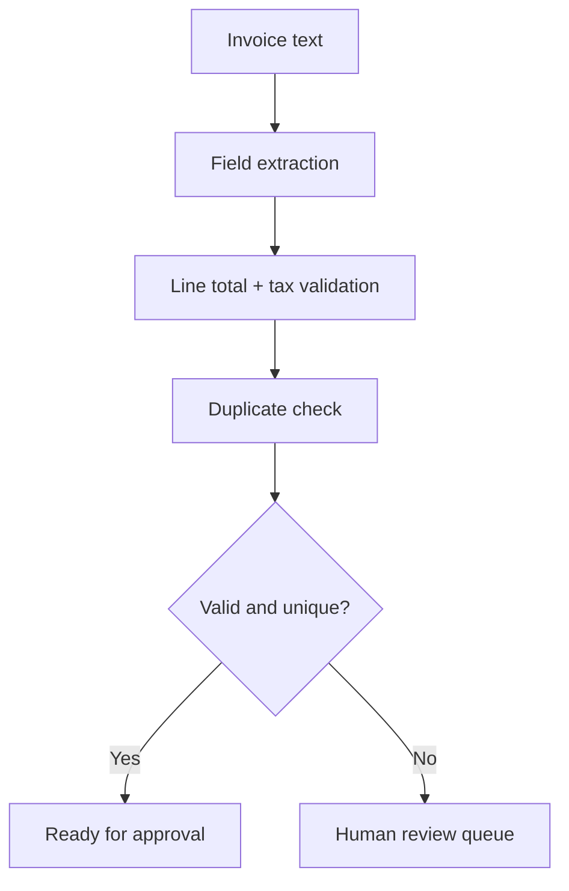

# AI Invoice Processing Automation

A local-first invoice operations demo that extracts common fields from structured invoice text, validates line-item totals, flags likely duplicate invoices, and routes exceptions to a human review queue.

**No paid AI API required.** The starter uses transparent parsing rules and synthetic examples so the workflow runs locally. OCR and LLM-based extraction are future integrations, not claimed as implemented.

## Features
- Parse invoice number, supplier, invoice date, due date, line items, subtotal, tax, and total from a documented text format.
- Validate arithmetic with configurable currency tolerance.
- Detect potential duplicates by normalized supplier + invoice number.
- Flag mismatched totals or missing required fields for human review.
- Track processing status in memory and expose JSON API endpoints.
- Synthetic invoice fixtures, tests, Docker, and an optional n8n workflow blueprint.

## Quick start
Requires Python 3.11+.

```bash
python -m venv .venv
source .venv/bin/activate  # Windows: .venv\Scripts\Activate.ps1
pip install -r requirements.txt
uvicorn app.main:app --reload
```

Open [http://127.0.0.1:8000](http://127.0.0.1:8000) or API docs at [http://127.0.0.1:8000/docs](http://127.0.0.1:8000/docs).

## Try a sample invoice
```bash
curl -X POST http://127.0.0.1:8000/invoices/process \
  -H "Content-Type: application/json" \
  -d @data/sample_invoice.json
```

The sample invoice JSON contains an invoice text body. The response includes parsed fields, validation checks, duplicate status, and the recommended route.

## Invoice text format
The parser supports labelled lines such as:
```text
Invoice Number: INV-1001
Supplier: Northwind Office Supplies
Invoice Date: 2026-01-10
Due Date: 2026-02-09
Item: Printer paper | 2 | 15.00
Item: Shipping | 1 | 5.00
Subtotal: 35.00
Tax: 2.80
Total: 37.80
```

Line item format is `Item: description | quantity | unit_price`. For production use, add OCR/document layout extraction, locale-aware decimal parsing, and vendor-specific templates.

## Workflow


## API
- `GET /health`
- `GET /invoices` — processed invoice summaries
- `GET /review-queue` — invoices requiring human review
- `POST /invoices/process` — parse, validate, and route an invoice

## Run tests and Docker
```bash
pytest -q
docker build -t ai-invoice-processing-automation .
docker run --rm -p 8000:8000 ai-invoice-processing-automation
```

## Safety and limitations
All sample records are synthetic. The API does not submit payments or approve invoices; it only recommends a route. Records are in memory and reset on restart. Before production, add authentication, durable audit trails, access control, encryption, vendor-specific parsing, and human approval before financial actions.

## Implemented vs. next steps
**Implemented:** text field extraction, arithmetic checks, duplicate detection, exception queue, API, tests, synthetic data.

**Next steps:** OCR for scanned PDFs, optional local LLM extraction, database persistence, n8n webhook orchestration, and accounting-system integration.

## License
MIT — see [LICENSE](LICENSE).
